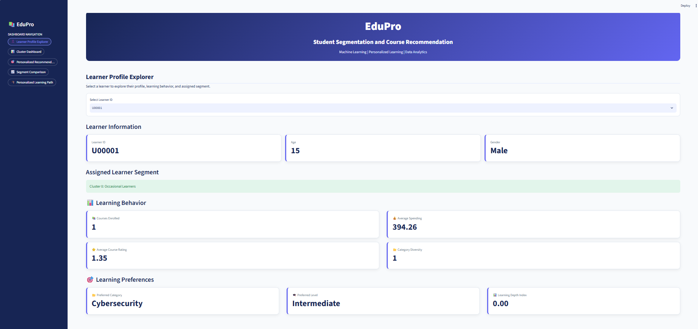
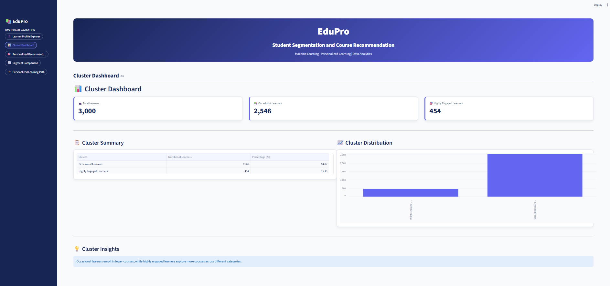
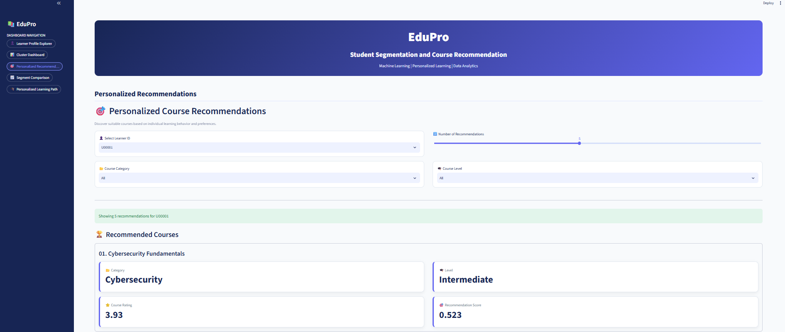
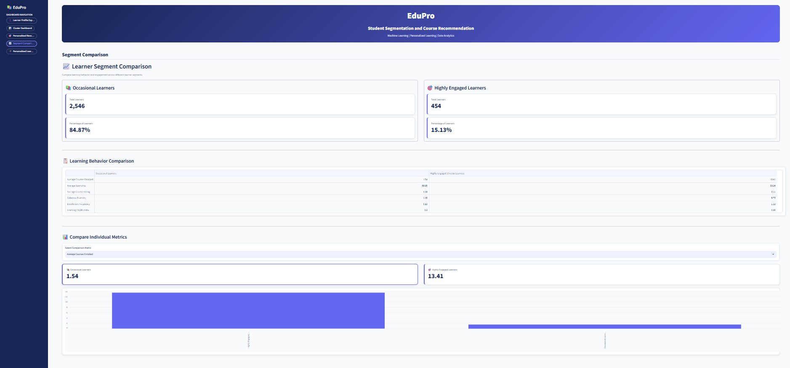
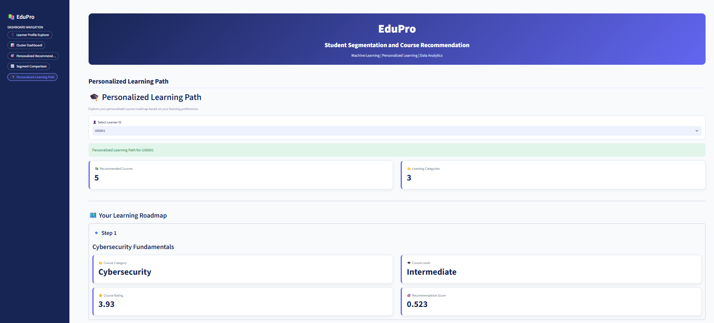

# 🎓 EduPro – Student Segmentation & Personalized Course Recommendation System

## 📌 Project Overview

EduPro is a Machine Learning-based project that analyzes student learning behavior, identifies learner segments, and provides personalized course recommendations using a hybrid recommendation system.

The project includes an interactive Streamlit dashboard for exploring learner profiles, comparing segments, and generating personalized learning paths.

## 🎯 Project Objectives

- Understand student learning behavior.
- Identify different learner segments.
- Provide personalized course recommendations.
- Evaluate clustering and recommendation performance.
- Visualize learning patterns through an interactive dashboard.

## 🛠️ Technologies Used

- Python
- NumPy
- Pandas
- Scikit-learn
- Matplotlib
- Seaborn
- Streamlit
- SciPy
- Joblib

## 📊 Dataset Overview

| Dataset | Records |
|---|---:|
| Learners | 3,000 |
| Courses | 60 |
| Transactions | 10,000 |
| Course Categories | 12 |
| Observation Period | 12 Months |

## ⚙️ Project Methodology

1. Data Cleaning and Preprocessing
2. Exploratory Data Analysis
3. Feature Engineering
4. K-Means Clustering
5. Hierarchical Clustering Validation
6. Student Segmentation
7. Hybrid Recommendation System
8. Model Evaluation
9. Interactive Dashboard Development

## 🧠 Student Segmentation Results

| Segment | Learners | Percentage |
|---|---:|---:|
| Occasional Learners | 2,546 | 84.87% |
| Highly Engaged, Diverse Learners | 454 | 15.13% |

## 🎯 Recommendation System

The hybrid recommendation system combines:

- Content-Based Filtering
- Cluster-Based Popularity
- Course Rating-Based Recommendations
- Similar-Learner Recommendations

The system recommends relevant courses while excluding previously enrolled courses.

## 📈 Model Evaluation

- Elbow Method
- Silhouette Score
- Adjusted Rand Index
- Precision@5
- Hit Rate@5
- Intra-Cluster Cosine Similarity
- Chronological Train-Test Evaluation

## 📸 Dashboard Screenshots

### 1. Learner Profile Explorer

Explore individual learner profiles, learning behavior, and preferences.

---

### 2. Cluster Dashboard

Visualize learner segmentation, cluster distribution, and key insights.

---

### 3. Personalized Recommendations

Explore personalized course recommendations with category and level filters.

---

### 4. Segment Comparison

Compare learning behavior and engagement across learner segments.

---

### 5. Personalized Learning Path

Explore a personalized course roadmap based on recommendation rankings.

---

## ✨ Key Features

- Interactive learner profile exploration
- Machine Learning-based student segmentation
- Hybrid course recommendation system
- Personalized recommendation explanations
- Category and level filters
- Dynamic segment comparison
- Personalized learning roadmap
- Professional Streamlit dashboard

## 🚀 Future Scope

- Real-time course recommendations
- Advanced Machine Learning algorithms
- User feedback integration
- Prerequisite-aware learning paths
- Privacy-safe demo dataset
- Cloud deployment

## 🔒 Data Privacy

Original datasets and sensitive model artifacts are not included in this public repository.

The repository demonstrates the project methodology, source code, and dashboard. Additional datasets and model artifacts are required to run the complete application.

## 🎓 Internship Project

Developed as part of a Data Science and Machine Learning internship at Unified Mentor.

⭐ If you find this project useful, consider starring the repository.
